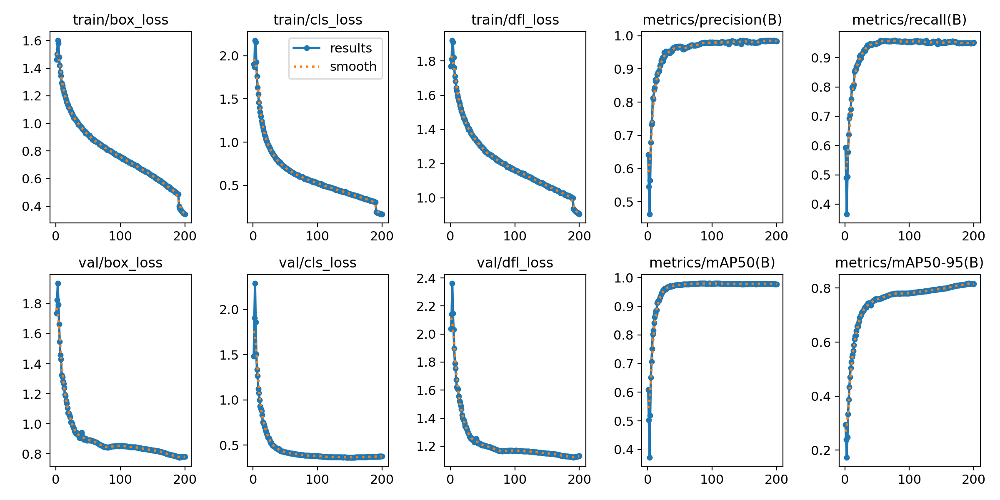
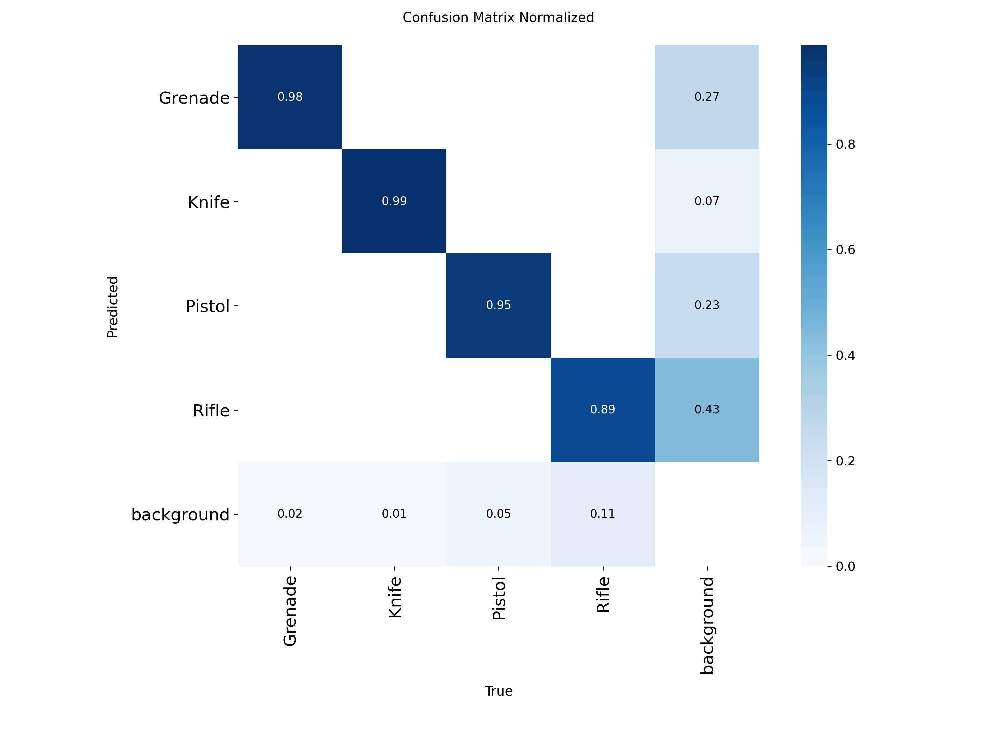

# Weapon Detection


ระบบตรวจจับอาวุธแบบ real-time ด้วย YOLO11 จากกล้อง/RTSP แล้วแจ้งเตือนผ่าน Telegram
Real-time weapon detection (YOLO11) with Telegram alerts.

**คลาสที่ตรวจได้:** `grenade`, `knife`, `pistol`, `rifle`

## ผลการเทรน
YOLO11m, 200 epochs — precision 0.983, recall 0.952, mAP50 0.978, mAP50-95 0.815 (validation)




## วิธีทำงาน
กล้อง → `VideoStream` → `WeaponDetector` (YOLO) → `AlertManager` (cooldown + history)
→ `EventLogger` (CSV + crop) และ `TelegramClient` (ส่งรูป) → `HUDOverlay` (แสดงผล)

## เริ่มใช้งาน
```bash
pip install -e ".[dev]"
cp .env.example .env        # ใส่ TELEGRAM_BOT_TOKEN และ TELEGRAM_CHAT_ID
python -m weapon_detection      # กด ESC เพื่อออก
```
ปรับค่าต่างๆ (กล้อง, threshold, cooldown) ใน `config.yaml`

## ความปลอดภัย
อย่า commit `.env` หรือ token ลง git. ถ้า token เคยหลุด ให้ revoke ที่ @BotFather ทันที

## โครงสร้างโปรเจกต์
```
src/weapon_detection/   โค้ดหลัก (app, detector, alert, hud, logger, telegram_client, video_stream, config)
tests/                  pytest
models/best.pt          โมเดลที่เทรนแล้ว
docs/                   กราฟผลเทรน
config.yaml             ตั้งค่า (ไม่มี secret)
```

## ทดสอบ
```bash
pytest && ruff check .
```

## License
MIT — ดู [LICENSE](LICENSE)
